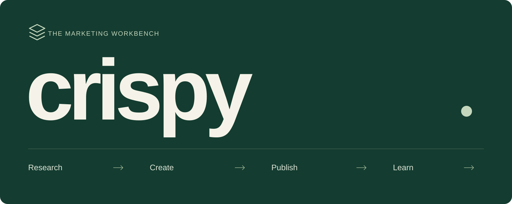

<p align="center">
  
</p>

<p align="center">
  <a href="#the-workbench">The workbench</a> &nbsp;·&nbsp;
  <a href="#magpie-integration">Magpie</a> &nbsp;·&nbsp;
  <a href="#run-locally">Run locally</a> &nbsp;·&nbsp;
  <a href="#whats-next">What's next</a> &nbsp;·&nbsp;
  <a href="PRODUCT.md">Product direction</a>
</p>

Marketing work belongs together. **crispy** connects product and competitor research, creative work, publishing, performance, and reusable knowledge in one workspace.

Research informs the brief. Creative work becomes something to review and publish. Results become context for the next decision. Agents handle execution underneath the workbench, with **Magpie** planned as the plugin-based agent integration.

> **Workbench preview** · Active development happens on [`workbench/main`](https://github.com/xolarvill/crispy/tree/workbench/main). The React console is being built alongside the existing FastAPI dashboard; some workflows still live in the legacy UI.

## The workbench

| Workspace | Available in the React console | Still to migrate |
| :--- | :--- | :--- |
| **Product research** | Shop-scoped research records, search and details | Research creation/execution; a dedicated SKU research workflow |
| **Competitor research** | Separate competitor task list and details | Research execution and evidence presentation |
| **Creative work** | Task creation, reference uploads, status filters, media previews and same-page galleries | Complete output review and advanced controls |
| **Publishing** | Schedule queries by shop and date, record details | Calendar editing and publishing actions |
| **Performance** | Shop/project metric summaries | Imports, sync controls, trends and deeper analytics |
| **Memory** | Independent memory library, search and details | Review, conflict resolution and governance actions |
| **Connections** | Shop/account management and credential environment mappings | Remote credential verification |

The backend already supports generation, research, review, memory and integrations. Availability in the new console is listed above; a backend capability does not imply a finished React workflow.

## Magpie integration

crispy is the workspace where marketing work is organized and reviewed. **Magpie** is planned as a plugin for connecting agent execution to that workspace through a local gateway using MCP.

The intended division is straightforward:

- **crispy** holds the marketing context: research, tasks, media, publishing, performance and memory.
- **The local gateway** provides the MCP communication boundary between the workbench and agents.
- **The Magpie plugin** connects agent capabilities to the workbench, rather than adding another standalone agent-management area to the console.

This is the integration direction, not an available installation path. The current backend still uses its existing agent runtime; the gateway, MCP contracts and Magpie plugin have not shipped.

## Run locally

Requires **Python 3.11+**, **uv**, and **Node.js/npm**.

```bash
git clone --branch workbench/main https://github.com/xolarvill/crispy.git
cd crispy
uv sync
```

**1. Start the API** in the repository root:

```bash
uv run uvicorn app.main:app --reload --host 127.0.0.1 --port 8000
```

**2. Start the workbench** in a second terminal:

```bash
cd frontend
npm ci
npm run dev -- --port 5174
```

Open [the workbench](http://127.0.0.1:5174/?mode=demo#/tasks). It starts with labelled **demo data**; no provider credentials are needed to explore it. Open [live mode](http://127.0.0.1:5174/?mode=live#/tasks) to use the local backend. The Vite proxy expects the API on port **8000**.

Demo records reset on reload. Live mode uses your database and configured providers; generation and research can incur provider charges.

### Configure connections

Set provider secrets in the backend process environment before starting the API. For example:

```bash
# macOS / Linux
export CRISPY_API_KEY_OPENAI="your-key"
```

```powershell
# Windows PowerShell
$env:CRISPY_API_KEY_OPENAI = "your-key"
```

| Connection | Environment variables |
| :--- | :--- |
| Model providers | `CRISPY_API_KEY_OPENAI`, `CRISPY_API_KEY_DEEPSEEK`, `CRISPY_API_KEY_KIMI` |
| Research | `CRISPY_API_KEY_TAVILY`, `CRISPY_API_KEY_FIRECRAWL` |
| Shopify | `CRISPY_API_KEY_SHOPIFY`, `CRISPY_API_KEY_SHOPIFY_DOMAIN` |
| Meta | `CRISPY_API_KEY_META`, `CRISPY_API_KEY_META_ACCOUNT` |
| Notion | `CRISPY_API_KEY_NOTION`, `CRISPY_API_KEY_NOTION_DATABASE` |

Configure provider/model routing in the existing dashboard. The new **shop and credential management** pages store environment-variable names, not secret values. A locally configured connection is not proof of successful remote authentication.

### Existing dashboard

The original dashboard remains available on the API server. The standalone launchers `./crispy` and `.\crispy.bat` open it on port **8849**; they do not start the React console. See the [legacy dashboard guide](docs/legacy-dashboard.md) for its setup, integrations, generation modes and earlier demos.

## What's next

- Complete research execution and evidence review in the new console.
- Bring memory review and conflict resolution into the workbench.
- Add schedule creation, editing, media selection and publishing.
- Migrate performance imports, sync controls and analysis.
- Implement the local MCP gateway and Magpie plugin described in [Magpie integration](#magpie-integration).

Workbench development integrates into **`workbench/main`**. It will merge into the repository's main release line, currently **`master`**, when ready.

The [marketing coverage and upstream vendor document](docs/marketing-skills-research.md) records the proposed work areas, user priorities, page boundaries, human–agent collaboration and social/email skill sources. It distinguishes user direction from pending proposals; those integrations have not shipped.

## Development

```bash
# Frontend: TypeScript checks and production build
cd frontend
npm run build

# Backend: from the repository root
uv run pytest tests/ -x -q
```

The production frontend bundle is not yet served by FastAPI. Live provider/platform integration is not covered by the browser fixture checks. Existing backend baseline failures are recorded in the [design review notes](docs/design/).

| Layer | Stack |
| :--- | :--- |
| Interface | TypeScript, React, Vite, Tailwind, shadcn-style source-owned controls, Lucide |
| API & execution | Python, FastAPI, Pydantic, background workers |
| Storage | SQLAlchemy, SQLite by default, local media files |
| Integrations | Shopify, Meta, Notion; Tavily/Firecrawl-backed research |

This is currently a single-user application with no authentication. Keep local instances private.

[Product direction](PRODUCT.md) · [Design system](DESIGN.md) · [Frontend notes](frontend/README.md) · [AGPL-3.0 license](LICENSE)
