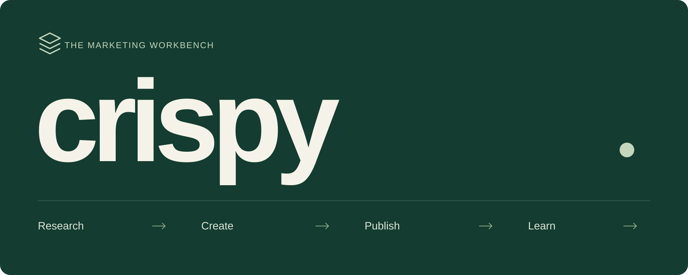

<p align="center">
  
</p>

<p align="center">
  <a href="README.md">English</a> &nbsp;·&nbsp;
  <a href="README.zh-CN.md">中文</a>
</p>

<p align="center">
  <a href="#工作台">工作台</a> &nbsp;·&nbsp;
  <a href="#magpie-集成">Magpie</a> &nbsp;·&nbsp;
  <a href="#本地运行">本地运行</a> &nbsp;·&nbsp;
  <a href="#下一步">下一步</a> &nbsp;·&nbsp;
  <a href="PRODUCT.md">产品方向</a>
</p>

营销工作本应放在一起。**crispy** 把产品与竞品研究、创意制作、发布、效果数据和可复用的知识连接在同一个工作空间里。

研究为 brief 提供依据，创意变成可审核、可发布的内容，结果又成为下一次决策的上下文。Agent 在工作台之下执行任务；**Magpie** 计划作为基于插件的 agent 集成。

> **工作台预览** · 当前开发在 [`workbench/main`](https://github.com/xolarvill/crispy/tree/workbench/main) 分支进行。React 控制台与现有的 FastAPI dashboard 并行开发，部分流程仍在旧版界面中。

## 工作台

| 工作区 | React 控制台已提供 | 待迁移 |
| :--- | :--- | :--- |
| **产品研究** | 店铺维度的研究记录、搜索与详情 | 研究的创建与执行；独立的 SKU 研究流程 |
| **竞品研究** | 独立的竞品任务列表与详情 | 研究执行与证据呈现 |
| **创意制作** | 任务创建、参考素材上传、状态筛选、媒体预览与同页图库 | 完整的产出审核与高级控制项 |
| **发布** | 按店铺和日期查询排期、记录详情 | 排期编辑与发布操作 |
| **效果** | 店铺/项目指标摘要 | 数据导入、同步控制、趋势与更深入的分析 |
| **记忆** | 独立的记忆库、搜索与详情 | 审核、冲突处理与治理操作 |
| **连接** | 店铺/账号管理与凭证环境变量映射 | 远程凭证校验 |

后端已经支持生成、研究、审核、记忆与集成。新控制台中的可用范围见上表；后端具备某项能力，并不意味着 React 工作流已经完成。

## Magpie 集成

crispy 是组织与审核营销工作的工作空间。**Magpie** 计划作为一个插件，通过基于 MCP 的本地网关，把 agent 执行接到这个工作空间里。

分工很直接：

- **crispy** 保存营销上下文：研究、任务、媒体、发布、效果和记忆。
- **本地网关** 提供工作台与 agent 之间的 MCP 通信边界。
- **Magpie 插件** 把 agent 能力接入工作台，而不是在控制台里再加一个独立的 agent 管理区。

这是集成方向，不是可用的安装方式。当前后端仍使用原有的 agent 运行时；网关、MCP 契约和 Magpie 插件都尚未发布。

## 本地运行

需要 **Python 3.11+**、**uv** 和 **Node.js/npm**。

```bash
git clone --branch workbench/main https://github.com/xolarvill/crispy.git
cd crispy
uv sync
```

**1. 在仓库根目录启动 API：**

```bash
uv run uvicorn app.main:app --reload --host 127.0.0.1 --port 8000
```

**2. 在第二个终端启动工作台：**

```bash
cd frontend
npm ci
npm run dev -- --port 5174
```

打开[工作台](http://127.0.0.1:5174/?mode=demo#/tasks)。它默认以标注清楚的**演示数据**启动，无需任何供应商凭证即可浏览。选择[本地 API 模式](http://127.0.0.1:5174/?mode=live#/tasks)可连接本地后端。Vite 代理期望 API 运行在 **8000** 端口。

演示记录在刷新后重置。本地 API 模式使用你的数据库和已配置的供应商；生成和研究可能产生供应商费用。

控制台**默认使用英文**。打开工作区侧栏底部的**设置**，即可在 **EN** 与 **中文** 之间切换界面语言，并修改数据模式；语言选择会保存在浏览器本地存储中。旧版 dashboard 的侧栏中也有 **Language / 语言** 切换，同样默认使用英文。

### 配置连接

启动 API 之前，在后端进程环境里设置供应商密钥，例如：

```bash
# macOS / Linux
export CRISPY_API_KEY_OPENAI="your-key"
```

```powershell
# Windows PowerShell
$env:CRISPY_API_KEY_OPENAI = "your-key"
```

| 连接 | 环境变量 |
| :--- | :--- |
| 模型供应商 | `CRISPY_API_KEY_OPENAI`、`CRISPY_API_KEY_DEEPSEEK`、`CRISPY_API_KEY_KIMI` |
| 研究 | `CRISPY_API_KEY_TAVILY`、`CRISPY_API_KEY_FIRECRAWL` |
| Shopify | `CRISPY_API_KEY_SHOPIFY`、`CRISPY_API_KEY_SHOPIFY_DOMAIN` |
| Meta | `CRISPY_API_KEY_META`、`CRISPY_API_KEY_META_ACCOUNT` |
| Notion | `CRISPY_API_KEY_NOTION`、`CRISPY_API_KEY_NOTION_DATABASE` |

在现有 dashboard 中配置供应商/模型路由。新的**店铺与凭证管理**页面只保存环境变量名，不保存密钥值。本地已配置连接，不等于远程认证成功。

### 现有 dashboard

原有 dashboard 仍可在 API 服务上访问。独立启动脚本 `./crispy` 和 `.\crispy.bat` 会在 **8849** 端口打开它；它们不会启动 React 控制台。安装、集成、生成模式和早期演示请参阅[旧版 dashboard 指南](docs/legacy-dashboard.md)。

## 下一步

- 在新控制台中完成研究执行与证据审核。
- 把记忆审核与冲突处理带进工作台。
- 增加排期创建、编辑、媒体选择与发布。
- 迁移效果数据导入、同步控制与分析。
- 实现 [Magpie 集成](#magpie-集成)中描述的本地 MCP 网关与 Magpie 插件。

工作台开发在 **`workbench/main`** 上集成，就绪后会合并到仓库的主发布线 **`master`**。

[营销覆盖范围与上游供应商文档](docs/marketing-skills-research.md)记录了拟议的工作领域、用户优先级、页面边界、人机协作方式以及社交/邮件技能来源。它区分了用户方向与待定提案；这些集成尚未发布。

## 开发

编码 agent 可以使用[本地营销方法](skills/README.md)完成产品知识、研究、社交/邮件/视频内容、审核、分析和发布交接。这些是仓库内的指令，不是已安装的后端或 Magpie 集成。参见[覆盖范围与来源设计](docs/local-skills-design.md)。

```bash
# 前端：TypeScript 检查与生产构建
cd frontend
npm run build

# 后端：在仓库根目录运行
uv run pytest tests/ -x -q
```

生产前端产物尚未由 FastAPI 提供。浏览器 fixture 检查不覆盖真实的供应商/平台集成。后端已有的基线失败记录在[设计评审笔记](docs/design/)中。

| 层 | 技术栈 |
| :--- | :--- |
| 界面 | TypeScript、React、Vite、Tailwind、shadcn 风格的源码自有控件、Lucide |
| API 与执行 | Python、FastAPI、Pydantic、后台 worker |
| 存储 | SQLAlchemy，默认 SQLite，本地媒体文件 |
| 集成 | Shopify、Meta、Notion；由 Tavily/Firecrawl 支撑的研究 |

当前是单用户应用，没有身份认证。请保持本地实例私有。

[产品方向](PRODUCT.md) · [设计系统](DESIGN.md) · [前端说明](frontend/README.md) · [AGPL-3.0 许可证](LICENSE)
